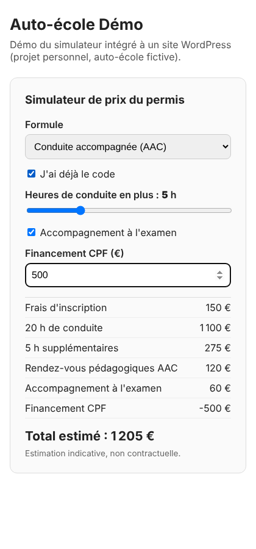

# Site WordPress – Auto-école Démo

Site vitrine WordPress d'une **auto-école fictive**, réalisé en projet personnel : pages de présentation, formulaire de demande d'inscription et **simulateur de prix du permis** codé en JavaScript.

👉 **Démo en ligne du simulateur :** https://buzz30gotcho.github.io/wordpress-autoecole-demo/

> Les noms, adresses, numéros et tarifs sont fictifs.

## Ce que j'ai réalisé

- **Installation de WordPress en local** avec LocalWP, y compris la gestion de la version de PHP pour assurer la compatibilité des extensions.
- **Thème responsive** et **4 pages** : Accueil, Formations, Tarifs, Contact, reliées par un menu de navigation.
- **Formulaire de demande d'inscription** avec l'extension Forminator : nom, email, téléphone, choix de la formation, message et consentement RGPD. Les envois sont enregistrés dans le tableau de bord et testés par email avec Mailpit.
- **Simulateur de prix du permis** en HTML, CSS et JavaScript, intégré dans un bloc « HTML personnalisé » :
  - choix de la formule (permis B, conduite accompagnée, conduite accélérée) ;
  - code déjà obtenu, heures de conduite supplémentaires, accompagnement à l'examen ;
  - déduction d'un financement CPF ;
  - détail ligne par ligne et total mis à jour en direct.
- **Vérification de l'affichage mobile** avec les outils de développement du navigateur.

## Technologies

WordPress · LocalWP · PHP · Forminator · HTML · CSS · JavaScript

## Captures d'écran

| Simulateur (mobile) |
|---|
|  |

<!-- Ajouter ici les captures du site : -->
<!--  -->
<!--  -->
<!--  -->

## Fichiers du dépôt

| Fichier | Contenu |
|---|---|
| `index.html` | Le simulateur, utilisable seul dans un navigateur (même code que sur le site WordPress) |
| `captures/` | Captures d'écran du site |

## Utiliser le simulateur dans WordPress

1. Ouvrir une page dans l'éditeur, ajouter un bloc **« HTML personnalisé »**.
2. Y coller le contenu de la `
`, la balise `<style>` et la balise `<script>` de `index.html`.
3. Mettre à jour la page, puis la vérifier sur le site (le script ne s'exécute pas dans l'éditeur).

Les tarifs se modifient en haut du script, dans l'objet `T`.

---

Réalisé par **Frédéric Makha SAR** – étudiant en Mastère 2 Développement Full Stack (YNOV).
